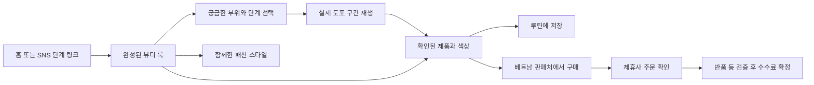

# STS 뷰티 통합 기획안 — 베트남 우선 출시

작성: 2026-11-04 · 단계: 기획 제안 · 서비스 코드 변경 없음

## 1. 제안하는 서비스

**STS는 베트남 고객이 실제 K뷰티 사용 영상을 보고, 궁금한 화장 과정을 골라 확인한 뒤, 정확한 제품과 색상을 현지 판매처에서 구매하도록 돕는 서비스다.**

브랜드의 중심은 뷰티로 통일한다. 패션은 같은 크리에이터의 완성된 룩을 구성하는 보조 카테고리로 유지한다. 홈·피드·숏폼·뷰티 체험은 공통 탐색과 콘텐츠 상세 경험을 사용한다. 크리에이터와 브랜드의 업무 도구는 같은 계정 안의 역할 메뉴로 제공한다.

고객에게 전달할 약속은 **“마음에 드는 메이크업, 바르는 방법부터 그 제품까지.”**다. 소비자는 무료로 이용하고, STS는 제휴사가 승인한 구매에서 수수료를 얻는다.

| 결정 | 이번 기획의 기준 |
|---|---|
| 첫 시장 | **베트남** — 사용자 확정 |
| 첫 고객 가설 | 숏폼에서 본 K뷰티 룩을 따라 하고 싶지만 제품·색상·사용 순서·현지 구매처를 찾기 어려운 성인 소비자 |
| 초기 콘텐츠 | 립 레이어링, 치크와 립 조합, 데일리 베이스 등 결과와 도포 장면이 잘 드러나는 메이크업 |
| 핵심 경험 | 완성 룩 → 부위/단계 선택 → 실제 도포 구간 → 확인된 제품·색상 → 현지 판매처 |
| 첫 거래 방식 | 현지 제휴 판매처에서 결제·배송·반품. STS는 콘텐츠와 구매 연결 담당 |
| 영상 확보 상태 | 사용자 확인상 사용 계약 없음. 촬영·허락 확보를 출시 작업에 포함 |
| 패션의 위치 | 탐색 카테고리와 룩 상세의 ‘함께한 스타일’. 기존 콘텐츠·저장 항목 보존 |
| 자동화 범위 | 자막·구간·제품 후보 작성 보조. 실제 사용 제품과 색상은 사람 검수 |

아래의 수량·일정·전환율·수수료율은 **계획 또는 계산 가정**이다. 확보한 계약, 시장 평균, 측정한 성과로 간주하지 않는다.

## 2. 현재 사이트에서 확인한 문제

검토 대상은 `STS-claude-visual-commerce-prd-m2xfdo` 저장소다. 배포된 서비스의 현재 상태를 직접 검증한 것은 아니다.

| 확인한 근거 | 현재 상태 | 기획에 미치는 영향 |
|---|---|---|
| `app/page.tsx`, `components/landing/ZvzoStyleLanding.tsx` | 홈이 크리에이터 협업·수익 설명 중심이며 체험과 피드로 여러 번 분기 | 소비자가 처음부터 쇼핑을 시작할 수 있게 홈의 역할 변경 |
| `app/demo/page.tsx` | Fashion / Beauty 데모 선택 화면 | 일반 고객 경로에서 개념 선택 관문 제거 |
| `components/AppShell.tsx` | 홈·릴스·뷰티 데모 등이 공통 셸에서 제외 | 주요 소비자 화면의 탐색·뒤로 가기·저장 동작 통일 |
| `components/Sidebar.tsx`, `components/TabBar.tsx` | 메인홈·피드·릴스·뷰티 데모·IR·운영 등 여러 목적이 혼재 | 소비자 탐색과 운영 기능의 노출 권한 정리 |
| `lib/beauty/demo-data.ts` | `videoSrc`가 JPG를 가리킴. 단계 시간과 제품 데이터는 입력돼 있음 | 실제 도포 영상과 입력된 제품·시간의 대응을 새로 검증해야 함 |
| 같은 파일, `components/beauty/BeautyProductSheet.tsx` | 일부 구매 URL이 브랜드 홈페이지이며 원화 가격 사용 | 베트남에서 구매 가능한 정확한 상품·색상·판매처 링크 필요 |
| `lib/analytics/attribution-engine.ts` | 브라우저 저장 이벤트와 고정 20% 마진을 이용한 정산 계산 존재 | 데모 계산과 실제 주문·수수료 원장을 분리해야 함 |
| `lib/affiliate/outbound.ts` | 검증된 offer와 승인된 제휴 URL을 검사하는 외부 이동 기반 존재 | 이 구조를 베트남 판매처와 연결하는 방안을 우선 검토 |
| `docs/BEAUTY_DEMO_MAP.md`, `docs/BUSINESS.md`, `DESIGN.md` | 과거 ‘자산 미확보’, 자동 인식 주장, 분리된 화면 방향 등이 함께 남음 | 구현 시 문서와 화면의 사실 기준을 하나로 맞출 필요 |

따라서 메뉴를 줄이는 작업과 함께, **영상·상품·구매·정산의 실제 연결**을 완성해야 한다. 원본 영상이 없는 단계 데이터는 검증된 사용 사실로 노출하면 안 된다. ‘공식 파트너’, ‘1초 결제’, ‘인식 정확도’ 같은 기존 문구도 근거와 실제 기능을 확인한 뒤 사용한다.

## 3. 고객이 STS를 사용할 이유

처음 검증할 질문은 세 가지다.

1. **“이 색을 어떻게 만들었지?”** — 제품명뿐 아니라 바른 순서, 횟수, 부위와 사용 장면을 제공한다.
2. **“내가 살 제품은 정확히 무엇이지?”** — 브랜드·상품·색상·용량을 구분하고, 실제 사용 제품과 대안을 명확히 표시한다.
3. **“베트남에서 어디서 살 수 있지?”** — 현지 재고, VND 가격, 배송 조건이 확인된 판매처로 연결한다.

SNS에서 STS로 이동할 이유는 궁금한 장면을 빠르게 찾아 재현할 수 있다는 점에 둔다. 핵심 유입 링크는 홈페이지보다 **특정 룩의 특정 단계**로 연결한다. 예를 들어 립 영상에서 넘어온 고객은 입술 도포 장면과 해당 색상을 바로 본다.

시장 배경으로 Google·Temasek·Bain의 2025년 보고서는 동남아 전자상거래 GMV에서 영상 커머스 비중이 25%에 이를 것으로 전망했다. 이는 영상 구매 경험의 중요성을 보여주는 과거 지역 지표이며, STS의 수요나 베트남 전환율을 입증하지는 않는다. [Google, e-Conomy SEA 2025](https://blog.google/company-news/inside-google/around-the-globe/google-asia/sea-economy-2025/)

## 4. 하나의 서비스로 보이는 구조

소비자 하단 메뉴는 **홈 / 탐색 / 저장 / 내 정보** 네 가지로 제안한다. 베트남어 표시 초안은 `Trang chủ / Khám phá / Đã lưu / Tôi`이며 현지 검수 후 확정한다.

| 기존 경로·기능 | 통합 후 역할 |
|---|---|
| `/`, `/home`, `/feed` | 홈에서 바로 실제 룩 탐색. 기존 링크는 새 홈으로 연결하고 필요한 필터 보존 |
| `/reels` | 별도 서비스 대신 홈 콘텐츠의 연속 시청 모드. 같은 룩 ID·저장 상태 사용 |
| `/beauty-demo` | 실제 콘텐츠 상세의 과정 선택 기능으로 편입. 기존 링크는 검증된 대표 룩이 준비된 뒤 연결 |
| `/demo` | 일반 고객 내비게이션에서 제외. 발표용 기능은 별도 관리 경로에 유지 가능 |
| `/post/[id]` | 공통 룩 상세의 기반 후보. 영상·사진·뷰티·패션이 같은 상세 문법 사용 |
| `/discover` | 부위·룩·제품·크리에이터 탐색. 패션도 여기서 명시적으로 접근 가능 |
| `/saved` | 저장한 룩·단계·제품·루틴을 한 곳에서 관리 |
| `/creator`, `/create`, `/analytics` | ‘내 정보 → 크리에이터 도구’ 아래 연결 |
| 브랜드 제휴·서비스 소개 | 푸터 또는 보조 메뉴. 소비자 첫 화면의 주 행동을 차지하지 않음 |
| `/admin`, IR 자료 | 운영자·내부 검토 경로. 고객 메뉴에서 제외 |

여러 URL은 공유·검색·뒤로 가기를 위해 유지한다. **헤더, 탐색, 콘텐츠 데이터, 로그인 상태, 저장과 구매 동작을 통일**하는 것이 통합의 기준이다. 기존 패션 게시물·작성자·저장 관계·공유 URL은 이관 목록으로 관리하고 삭제하지 않는다.

### 홈 구성

- 상단: STS, 검색, 국가·언어. 초기 기본값은 베트남·베트남어이며 변경 가능.
- 첫 영역: 실제 완성 룩과 도포 장면이 있는 세로 영상. 설명은 한 문장, 주 행동은 ‘바르는 과정 보기’.
- 첫 영상 아래: 립·치크·베이스 등 쉬운 탐색 칩과 확인된 사용 제품으로 바로 가는 입구.
- 이어지는 콘텐츠: 상황별 룩, 같은 제품을 다른 크리에이터가 사용한 영상, 저장한 루틴 이어 보기.
- 방문·시청·상품 확인·외부 구매 이동에 회원가입을 요구하지 않는다. 기기 내 임시 저장을 제공하고 기기 간 동기화 때 가입을 제안한다.

### 시각 방향

기존 `DESIGN.md`의 중립적인 배경·텍스트·절제된 뷰티 강조색을 출발점으로 삼는다. 구현 전에 충돌하는 ‘분리된 랜딩/뷰티 모드’ 규칙을 통합 방향으로 개정한다. 실제 피부 질감·제품 제형·도포 동작이 화면의 중심이어야 한다.

모바일에서는 영상 아래에 단계와 상품 시트를, 데스크톱에서는 영상 옆에 같은 단계·상품 패널을 둔다. 데스크톱도 작은 휴대폰 모형만 보여주는 구성으로 제한하지 않는다. 메이크업 색에 영향을 주는 컬러 필터나 과도한 피부 보정은 시연에 사용하지 않는다.

## 5. 화장 과정 선택과 상품 레이어

‘상품 레이어’는 두 가지를 구분해 설계한다. **영상 위에 표시하는 상품 정보**와 **실제로 겹쳐 바르는 메이크업 단계**다.

| 상태·행동 | 사용자에게 보이는 것 | 동작 규칙 |
|---|---|---|
| 룩 처음 열기 | 완성 룩, 제목, 크리에이터, ‘과정’, ‘사용 제품’ | 완성본 구간은 검증된 경우에만 반복. 바로 상품 확인도 허용 |
| 부위 선택 | 베이스·눈·치크·립 등 실제 영상에 있는 부위 | 얼굴을 누르는 방식과 텍스트 버튼을 함께 제공 |
| 단계 선택 | 예: 립 바탕 → 틴트 → 글로스 | 선택 구간 시작으로 이동. 같은 부위의 여러 도포 단계를 별개로 관리 |
| 과정 재생 | 현재 단계, 짧은 사용 설명, 활성 상품 칩 한 개 | 제품이 등장하지 않는 구간에 잘못 표시하지 않음. 도포 부위를 가리지 않음 |
| 제품 칩 열기 | 정확한 제품·색상, 실제 사용 근거, 현지 판매처 | 모바일 시트는 영상과 가독성 균형을 유지. 닫으면 재생 위치와 선택 복원 |
| 전체 루틴 | 영상에 확인된 적용 순서와 제품 목록 | 단계별 보유/저장 선택. 동일 SKU 중복 구매를 피하도록 목록 정리 |
| 다른 색상 선택 | ‘같은 제품·다른 색상’ 또는 ‘비슷한 대안’ 표시 | 원본 영상의 실제 색상이 바뀐 것처럼 얼굴을 재합성하지 않음 |
| 관련 패션 열기 | 같은 룩의 의상·액세서리 | 실제 착용 확인 제품과 스타일 제안을 구분 |

**필수 원칙**

- 실제 순서는 영상 기준이다. 모든 영상에 8단계를 강제하지 않는다. 한 제품을 두 번 바르면 두 단계가 될 수 있다.
- 선택한 부위는 관련 단계만 필터링한다. 완성된 얼굴을 눌렀다고 특정 화장품이 자동 식별되었다고 주장하지 않는다.
- 여러 상품을 한 단계에서 섞었다면 복수 제품으로 표시하고, 확인되지 않은 배합 비율은 만들지 않는다.
- 핫스폿은 첫 버전에 수동 검수한 구간·위치만 사용한다. 얼굴이 이동하거나 가려지는 구간은 숨기고 단계 버튼으로 조작한다.
- 원본 영상이 바뀌면 타임스탬프·핫스폿 검수를 다시 한다. 사용량·레이어 횟수도 영상 또는 크리에이터 확인이 있을 때만 노출한다.
- 구간 종료 시 다음 단계·다시 보기 선택을 제공한다. 전체 영상 모드에서는 자연스럽게 계속 재생한다.
- 영상을 끝까지 보아야 가격이나 제품이 열리는 강제 장치는 두지 않는다.
- ‘루틴 저장’은 구매 목록이다. 서로 다른 판매처 상품을 실제로 결제할 수 없는 상태에서 ‘한 번에 결제’라고 표시하지 않는다.
- 재생 실패에는 재시도와 확인된 단계 설명을 제공하되, 영상이 재생된 것처럼 진행률을 올리지 않는다.
- 자막, 소리 끄기, 키보드 조작, 선택 상태 읽기, 충분한 터치 영역을 제공한다. 필수 조작을 호버나 얼굴 인식에만 의존하지 않는다.

### 영상 출처에 따른 표시 차이

직접 사용 허락을 받은 원본에는 계약 범위 내에서 자체 플레이어와 상품 레이어를 적용한다. 외부 플랫폼 임베드는 해당 플랫폼이 허용하는 기능만 사용한다. 특히 YouTube는 임베드 플레이어 앞에 상품 오버레이 등을 표시하거나 플레이어를 가리는 것을 제한하므로, 상품 정보는 옆이나 아래에 둔다. [YouTube 필수 기능 정책](https://developers.google.com/youtube/terms/required-minimum-functionality)

## 6. 어떤 영상을 확보할 것인가

처음에는 **크리에이터 3~5명, 검증용 룩 10개, 출시 후보 룩 최대 30개, 정확한 제품·색상 SKU 20~30개**를 목표로 한다. 계약과 현지 재고가 부족하면 수량을 줄인다.

| 콘텐츠 묶음 | 고객 질문 | 필요한 촬영 장면 |
|---|---|---|
| 립 레이어링 | 이 발색은 제품 하나인가, 두 개를 겹쳤나? | 바르기 전, 각 제품 패키지·색상, 1차·2차 도포, 최종 클로즈업 |
| 치크·립 조합 | 이 룩의 색 조합과 바른 위치는? | 볼 도포 방향, 양, 립과 함께 보이는 완성 얼굴 |
| 데일리 베이스 | 얼마나 바르고 어떤 질감으로 마무리되나? | 한 번 덜어낸 양, 부분 도포, 피부 질감, 동일 조명 완성본 |
| 스킨 프렙 | 메이크업 전에 무엇을 어떻게 썼나? | 실제 도포 순서와 제형. 장기 효능을 단기 영상으로 입증하는 표현 제외 |

기본 촬영 요청은 세로 9:16 원본, 가능하면 1080p 이상, 일정한 조명과 화이트밸런스, 음악 없는 음성 원본이다. 이는 제작 제안이며 모든 기존 영상의 필수 형식은 아니다. 짧은 룩 영상과 단계별 구간을 원본에서 함께 제공받는다. 긴 설명 영상도 구간 정보가 정확하면 사용할 수 있다.

**선정 순서:** 권리 확인 → 베트남 구매 가능 여부 → 실제 도포·색상 확인 → 현지 고객에게 설명 가치가 있는지 → 촬영 품질. 조회수는 보조 지표다.

국적만으로 피부톤·피부타입을 추정하지 않는다. 다양한 피부톤의 실제 사용 장면을 확보하고, 피부타입 등은 본인이 제공하고 공개에 동의한 정보만 표시한다. 화면 조명과 디스플레이에 따라 발색이 달라질 수 있음을 제품 비교에서 설명한다.

## 7. 비용을 낮추면서 영상 권리를 확보하는 방법

현재 수익이 없다는 사실만으로 타인의 영상 다운로드·재게시·편집이 허용되지는 않는다. 공개된 콘텐츠라도 라이선스, 권리자 허락, 해당 국가의 예외가 적용되는지를 확인해야 한다. 출처 표기만으로 허락을 대신할 수 없다. [WIPO 저작권 FAQ](https://www.wipo.int/en/web/copyright/faq-copyright)

| 확보 방식 | 권장 용도 | 확인할 사항 |
|---|---|---|
| SNS 원문 링크 | 기획·콘텐츠 후보 조사 | 원문 URL, 작성자, 후보 이유 기록 |
| 공식 임베드 | 허용 범위의 참고 콘텐츠 | 임베드·상업적 표시 조건, 원본 삭제 시 처리, 플레이어 제약 |
| 크리에이터의 무료 파일럿 허락 | 초기 핵심 영상 확보 | 대상 영상, 기간, STS 웹 공개, 편집·번역·상품 연결 권한을 명시 |
| 소규모 신규 촬영 | 대표 룩과 정확한 제품 매핑 | 촬영자·출연자 권리와 음악, 제품·색상 확인 |
| 브랜드 제공 영상 | 보조 시연·제품 설명 | 브랜드가 재사용을 허락할 권한이 있는지, 모델·음원·편집 범위 확인 |
| 다운로드한 타인 영상 | 허락 확인 후 사용 여부 결정 | 다운로드 기능의 존재를 STS 재게시 허락으로 간주하지 않음 |

파일럿은 **비독점·기간 한정·범위가 명확한 무료 사용 허락**부터 제안할 수 있다. 예를 들어 90일 웹 공개, 베트남어 자막, 구간 재생, 상품 정보 표시를 협의한다. 향후 수수료 발생까지 허용받으면 초기부터 그 범위를 적고, 비상업 테스트만 허용받았다면 수익화를 시작하기 전에 권한을 확장한다.

영상별로 원저작자·촬영자·출연자, 원본 제공 경로, 허락 증빙, 이용 매체·지역·기간, 번역·크롭·클립·썸네일 권한, 상품 연결, 음원, 출처 표시, 만료·철회 조건을 기록한다. 광고 집행·타 플랫폼 재배포·AI 학습은 별도 선택 항목으로 둔다. 공개 웹은 해외에서도 접근되므로 ‘베트남 대상 마케팅’과 ‘베트남에서만 재생 허용’의 차이를 계약에서 확인한다.

음악은 별도로 확인한다. TikTok의 공식 안내는 Commercial Music Library 음악을 TikTok 내 사용으로 설명한다. 따라서 TikTok에서 쓸 수 있는 음악을 STS 웹사이트에도 사용할 수 있다고 가정하지 않는다. 음악 없는 원본이나 웹 상업 사용이 허용된 음원을 우선한다. [TikTok 음악 사용 안내](https://ads.tiktok.com/business/library/TikTok_Music_Legality.pdf)

운영 상태는 `검토 중 → 허락 확인 → 제품 검수 → 공개 → 만료/중단`으로 관리한다. 만료·권리 신고 때는 영상뿐 아니라 클립·썸네일·캐시·연결된 노출도 중단할 수 있어야 한다. 허락 증빙은 공개하지 않고 권한 있는 운영자만 접근한다. 실제 계약과 국가별 예외 판단은 출시 전에 현지 전문가의 검토를 받는다.

## 8. 베트남에서 실제로 구매할 수 있는 상품

첫 버전은 **베트남에 이미 적법하게 유통되는 상품과 현지 판매처**를 우선한다. STS의 직접 수입·재고·배송은 별도 사업 검증 후 결정한다.

상품 데이터는 세 층으로 나눈다.

| 단위 | 필요한 정보 |
|---|---|
| 제품 | 브랜드, 상품명, 성분·용량, 공식 자료 출처 |
| 옵션 | 정확한 색상명·번호·용량·세트 구성, 크리에이터 확인 여부 |
| 판매 제안 | 베트남 판매자, 해당 옵션 URL, VND 가격, 재고, 배송 범위·비용, 반품 조건, 확인 시각, 제휴 가능 여부 |

영상에는 실제 사용 옵션을 연결하고, 구매 버튼에는 그 옵션을 제공하는 판매 제안을 연결한다. 브랜드 홈페이지나 검색 결과는 정확한 옵션 구매 링크로 표시하지 않는다. 원화 환산값을 현지 실제 판매가처럼 제시하지 않는다.

제품 매칭 표시는 다음으로 통일한다.

- **영상에서 사용한 제품·색상**: 원본과 크리에이터 또는 신뢰할 자료로 확인.
- **같은 제품·다른 색상**: 현재 영상과 다른 옵션임을 명시.
- **비슷한 대안**: 유사 근거를 설명하고 동일 발색·효과를 보장하지 않음.
- **확인 중**: 실제 사용 제품이라고 주장하지 않으며 구매 연결을 보류.

베트남 공식 무역 포털은 화장품 유통에 제품 신고 접수번호와 현지 책임 주체 등을 요구하는 제도를 안내한다. 판매처로부터 적용되는 신고·표시·유통 근거를 받고, 출시 시점의 개정 규정과 해당 제품 적용 여부를 확인한다. ‘한국에서 판매됨’이나 다른 ASEAN 국가의 신고만으로 베트남 판매 요건을 충족한다고 간주하지 않는다. [베트남 무역 포털: 화장품 관리](https://vietnamtradeportal.gov.vn/index.php?id=293&r=site%2Fdisplay)

베트남 개정 광고법은 2026-01-01 시행되었고, 정부는 인플루언서의 광고 책임과 허위 효능 표현을 강조하고 있다. 제품 광고·협찬·제휴 관계를 베트남어로 알아보기 쉽게 표시하고, 효능 표현은 현지 승인·증빙 범위를 검토한다. 화장품 신고는 정부의 효과 보증처럼 표현하지 않는다. [광고법 시행 정보](https://vanban.chinhphu.vn/?classid=1&docid=214561&pageid=27160), [정부의 인플루언서 광고 안내](https://tphcm.baochinhphu.vn/chan-chinh-quang-cao-sai-su-that-cua-nguoi-noi-tieng-tren-mang-10126091020372194.htm)

초기 제휴 연결 후보는 Lazada Vietnam과 현지 브랜드·공식 유통사다. 후보 중 **정확한 상품 링크, 외부 웹 유입, 크리에이터 수익 배분, 주문 결과 확인**이 계약상 가능한 한 곳부터 연결한다. Lazada Vietnam FAQ는 외국 개인·해외 기업 등에 제휴 계약 절차를 안내하지만, STS가 승인받았다는 의미는 아니다. 수수료·귀속 기간·공제·지급 조건은 실제 계약으로 확정한다. [Lazada Vietnam FAQ](https://pages.lazada.vn/wow/i/vn/corp/affiliate-faq), [제휴 약관](https://pages.lazada.vn/wow/i/vn/corp/affiliate-terms)

구매 버튼 근처에는 판매처, 배송 정보 확인 상태, 제휴 관계를 표시한다. 예시 문구는 “이 링크를 통해 구매하면 STS와 크리에이터가 수수료를 받을 수 있습니다.”다. 배송·반품은 판매처 조건을 보여주며 STS가 처리하는 범위를 명확히 한다.

## 9. 수수료가 실제로 남는 구조

기존 문서의 크리에이터 70%·STS 30%는 **제휴 수수료를 나누는 안**으로 검토한다. 상품 판매액의 30%가 STS에 남는 구조가 아니다. 실제 계약이 없는 현재에는 화면에서 확정 수익으로 약속하지 않는다.

### 가상의 주문 한 건

| 항목 | 계산 가정 |
|---|---:|
| 수수료 산정 대상 주문 금액 | 400,000 VND |
| 제휴 수수료율 | 10% |
| 승인된 총 수수료 | 40,000 VND |
| 크리에이터 몫 70% | 28,000 VND |
| STS 몫 30% | **12,000 VND** |

12,000 VND에서 영상 확보·호스팅·검수·지급 비용 등을 부담한다. 세금·공제·환전 비용은 실제 계약에 따라 별도 계산한다. 위 10%는 시장 평균이나 제공받은 조건이 아니다.

### 방문 10,000회에 대한 민감도 예시

고유 방문 세션 10,000회 중 20%가 판매처로 이동하고, 그 이동 세션의 3%에서 주문 한 건이 발생하며, 주문의 85%가 최종 승인된다고 가정한다.

`10,000 × 20% × 3% × 85% = 승인 주문 51건`

`51 × 400,000 VND × 10% × 30% = STS 몫 612,000 VND`

이는 비용 차감 전 STS 몫이며 순이익이 아니다. 방문 세션당 61.2 VND에 해당한다. 이 예시에서는 유료 트래픽을 많이 사오면 손실이 날 수 있다. 실제 회수되는 수수료로 고객 유입 비용의 한도를 정해야 한다.

| 가정 수수료율 | 같은 주문 금액에서 STS 몫 |
|---|---:|
| 5% | 6,000 VND |
| 10% | 12,000 VND |
| 15% | 18,000 VND |

콘텐츠 한 묶음 확보에 3,000,000 VND를 지출하고 주문당 STS 몫이 12,000 VND라면, 다른 비용을 제외해도 250건의 승인 주문이 필요하다. **높은 크리에이터 배분과 높은 선제작비를 동시에 지급하는 구조**는 콘텐츠별 손익을 확인해야 한다.

초기에는 무료 또는 낮은 고정비의 파일럿 허락, 반복해서 활용 가능한 영상, 크리에이터 자체 유입, 현지 판매 가능 상품 집중으로 비용을 관리한다. 브랜드가 부담하는 콘텐츠 제작비는 제휴 수익과 별도 계정으로 기록하고 협찬을 표시한다. 향후 수수료 배분 변경은 기존 합의와 창작자의 권리를 존중하며 신규 계약에서 협의한다.

## 10. 클릭과 실제 매출의 구분

`영상 → 단계 → 상품 옵션 → 판매 제안 → click_id → 제휴사 주문 → 검증 → 수수료 확정 → 지급`

- STS 내부에는 영상·단계·옵션·크리에이터와 무작위 click_id의 관계를 저장한다. 외부에는 제휴사가 허용하는 추적 값만 전송하며 개인정보를 넣지 않는다.
- 구매처로 이동한 클릭은 구매가 아니다. 브라우저의 `checkout_completed` 이벤트를 확정 주문으로 집계하지 않는다.
- 주문은 제휴사가 제공하는 API·포스트백·공식 정산 파일로 확인한다. 지원 여부를 계약 전에 확인한다.
- 동일 주문·상품 행·상태 변경은 중복 반영하지 않는다. `접수 / 승인 대기 / 확정 / 반려·취소 / 지급`을 구분한다.
- 최종 수수료 귀속은 해당 제휴사의 규칙을 따른다. STS의 장면 기여도 분석이 제휴사의 마지막 클릭 등 귀속 규칙을 바꾸지는 않는다.
- 모바일 앱 전환, 다른 기기 구매, 다른 제휴 링크 재클릭, 반품·취소에 따른 누락을 측정 한계로 기록한다.
- 판매처가 SKU나 클릭 단위 주문 데이터를 제공하지 않으면 측정 가능한 단위까지만 보고한다. ‘이 장면 때문에 팔렸다’는 인과관계를 확정하지 않는다.
- 출시 전 제휴사가 허용하는 테스트 방식으로 클릭부터 주문·반품 조정까지 대조한다. 금지된 자기구매나 허위 주문으로 검증하지 않는다.

개인정보는 필요한 최소 이벤트만 수집한다. 첫 버전에서 얼굴 생체정보 수집이나 피부 진단을 요구하지 않는다. 국가별 동의·보관·삭제·국외 이전 적용과 외부 임베드의 추적 동작은 출시 체크에 포함한다.

## 11. 초기 유입과 반복 사용

**공급 확보 → 구매 가능한 룩 발행 → 크리에이터의 기존 채널 유입 → 단계 확인 → 구매·저장 → 잘 팔리는 룩 확장** 순서로 운영한다.

1. 베트남어로 설명 가능한 소규모 크리에이터·메이크업 아티스트 후보를 선정한다. 팔로워 수보다 실제 질문, 촬영 품질, 제품 확인 가능성을 본다.
2. 현지에서 살 수 있는 제품 목록을 먼저 합의하고 영상을 확보한다. 품절·미유통 제품에 촬영비를 쓰는 일을 줄인다.
3. 각 영상에 STS 단계별 링크를 제공한다. 링크에 약속한 정보가 첫 화면에 바로 나타나게 한다.
4. 댓글에서 반복되는 ‘제품명·색상·사용법’ 질문을 다음 콘텐츠의 주제로 활용한다. 크리에이터 채널에서의 게시·메시지는 별도 실행 승인 범위에서 진행한다.
5. 저장한 루틴, 이미 보유한 제품, 같은 색상의 다른 사용 예시, 허용된 재입고 알림으로 재방문 이유를 만든다.
6. 베트남어 검색 유입은 ‘브랜드+색상+사용법’ 같은 정확한 콘텐츠부터 만든다. 영상 자막·단계 설명·제품 근거를 제공한다.

첫 콘텐츠 편성의 제안 비중은 뷰티 85~90%, 관련 스타일 10~15%다. 이는 브랜드 집중도를 검증하기 위한 시작값이다. 패션 소비자의 기존 저장·공유 진입은 계속 지원하며 실제 반응에 따라 조정한다.

## 12. 첫 MVP와 이후 범위

| 첫 MVP에 포함 | 검증 후 확장 |
|---|---|
| 베트남어 홈·탐색·저장·룩 상세 | 다국가 동시 운영 |
| 권리 확인된 영상과 수동 단계 매핑 | 자동 구간·얼굴 위치 추적 확대 |
| 실제 사용 제품·옵션·현지 판매처 | 광범위한 자동 상품 식별 |
| 단계 선택·제품 시트·루틴 저장 | 가상 메이크업 시뮬레이션 |
| 한 제휴 채널의 클릭·주문·수수료 대조 | 여러 판매처 통합 결제·자체 배송 |
| 권리·제품·영상 검수 운영 화면 | 공개 업로드·라이브 방송·대규모 커뮤니티 |
| 관련 패션 탐색과 기존 링크 보존 | 독립적인 패션 사업 확장 |

공개 피드 규모보다 **룩 하나의 전 과정이 실제로 완성되는지**를 먼저 검증한다. 초반에는 AI가 없어도 수동 검수로 운영 가능해야 한다.

## 13. 첫 6주 실행 순서

일정은 소규모 제품·제휴 담당이 함께 일한다는 가정이다. 계약·자산 확보가 늦어지면 공개 일정을 조정한다. 이 문서는 실행 계획이며 아직 구현·제휴 요청·영상 다운로드를 수행한 상태가 아니다.

| 기간 | 할 일 | 책임 역할 | 완료 기준 |
|---|---|---|---|
| 1주 | 베트남 소비자 10명 내외 인터뷰, 콘텐츠 후보 조사, 판매처·제휴 가능성 확인 | 제품·제휴 | 우선 고객 질문 3개, 판매처 조건표, 촬영·권리 확보 방식 |
| 2주 | 크리에이터 3명 이상 파일럿 협의, 영상 10개·SKU 20개 검수 목표 | 제휴·콘텐츠 검수 | 허락 증빙, 실제 영상, 정확한 제품·색상·현지 구매 가능성 |
| 3주 | 공통 셸·홈·룩 상세, 단계 선택·상품 시트 구현 | 제품·개발 | 별도 데모 관문 없이 같은 룩에서 과정과 제품 확인 |
| 4주 | VND 판매 제안·저장·제휴 추적·권리 만료 처리, 현지어 검수 | 개발·운영 | 허용된 주문 테스트 대조, 링크·옵션·권리 오류 해소 |
| 5주 | 소규모 비공개 사용성 검증과 크리에이터 유입 테스트 | 제품·콘텐츠 | 단계 찾기·제품 구분·구매처 이동 과업 결과와 이탈 원인 |
| 6주 | 제한 공개, 소스·크리에이터별 전환 및 비용 관찰 | 제품·제휴 | 관측 데이터에 따른 유지·수정·확장 결정 |

30일에는 실제 콘텐츠와 사용성을, 60일에는 귀속·전환을, 90일에는 가능한 범위의 승인·지급 수수료와 재방문을 검토한다. 정산 기간이 더 길면 매출 성공 판단을 기다린다.

## 14. 무엇이 확인되어야 확장할 것인가

| 판단 대상 | 지표·확인 방법 | 초기 기준의 성격 |
|---|---|---|
| 권리와 정보 | 공개 영상 허락·음원·제품·색상 검수 완료 비율 | 공개 대상 100%를 요구하는 운영 기준 |
| 이해 가능성 | 초대 사용자 10명 중 도움 없이 단계·제품·판매처를 찾은 수 | 8명 이상을 사용성 목표로 제안. 통계적 시장 검증은 아님 |
| 시청 품질 | 실제 재생 시작률, 오류·버퍼링, 단계 이동 성공 | 기기·네트워크별 측정. 포스터 노출을 영상 시청으로 집계하지 않음 |
| 상품 관심 | 상품을 연 고유 세션 / 룩 상세를 본 고유 세션 | 기준선 수집 후 개선 목표 설정 |
| 구매 이동 | 판매처로 이동한 고유 세션 / 룩 상세 고유 세션 | 반복 클릭 중복 제거, 콘텐츠·유입원별 비교 |
| 실제 전환 | 제휴사가 확인한 주문 및 최종 승인 비율 | 클릭 수와 분리, 승인 지연을 같은 코호트로 추적 |
| 사업성 | 승인 수수료 − 크리에이터 배분 − 변동비 − 콘텐츠비 배분 | 양의 공헌이익을 확인한 유입·콘텐츠부터 확대 |
| 반복 가치 | 첫 저장 후 7일·30일 내 재방문, 루틴 재사용 | 동일 사용자 정의·동의 범위·기기 변경 한계를 함께 기록 |

**확장 조건:** 적어도 하나의 콘텐츠 묶음과 유입 경로에서 실제 승인 주문·수수료가 확인되고, 비용을 감당하며, 사용자가 정보를 이해한다. 콘텐츠가 반복 공급될 수 있어야 한다.

**수정 조건:** 시청은 하지만 제품 확인이 적으면 단계와 상품 연결을 수정한다. 판매처 이동은 많지만 주문이 적으면 가격·색상·재고·배송·앱 전환을 점검한다. 주문은 나지만 STS에 남지 않으면 제휴 조건·고정 콘텐츠비·유입 방식을 수정한다. 승인 주문 확인이 불가능하면 수익성 검증 완료로 보고하지 않는다.

첫 비교 실험은 같은 라이선스 영상에서 ‘일반 제품 목록’과 ‘단계 연동 제품 목록’을 비교하는 것으로 제안한다. 상품·가격·유입원을 가급적 같게 유지하고, 사용성·구매 이동·확정 전환을 함께 본다. 표본이 적으면 효과 크기와 불확실성을 보고하며 승리 수치를 만들지 않는다.

## 15. 구현 착수 전 필요한 산출물

1. 베트남 파일럿 크리에이터별 사용 허락과 실제 원본 영상.
2. 영상별 단계·제품·색상·사용법 검수표.
3. 베트남 판매처·옵션별 구매 링크와 제휴 조건표.
4. 통합 홈·룩 상세·제품 시트의 모바일/데스크톱 설계.
5. 기존 경로·저장·패션 콘텐츠의 이관 표.
6. 클릭부터 승인 수수료까지의 측정·정산 정의.

현 시점의 우선순위는 **권리 확인된 베트남어 룩 10개와 구매 가능한 상품 20개로, 하나의 통합 경험을 검증하는 것**이다.

## 16. 참고 검토와 한계

[Shorti](https://shorti.dev/ko)의 현재 공개 페이지는 숏폼 트렌드·분석·코칭 서비스를 설명한다. 페이지 텍스트에서 실제 영상의 중요한 순간에 설명을 연결하는 방식을 확인했다. STS에는 이 설명 방식을 참고하며, Shorti의 영상이나 권리·데이터를 사용할 수 있다고 가정하지 않는다. 이 세션의 브라우저 제어는 비활성 상태라 Shorti의 현재 인터랙션을 직접 실행·검증하지 못했다.

Lazyweb에서 `shoppable video feed`, 모바일 조건으로 1회 검색했다. YouTube의 영상 연계 상품 목록과 eBay·Poshmark의 영상 탐색 화면이 반환되었으며, 뷰티의 단계별 구매 전환에 대한 실측 증거로 사용하지 않았다.

[Lazyweb 시안 보고서](https://www.lazyweb.com/report/lazyweb/601163fa-366e-4df2-aa7f-cb268002846e/?source=create)를 생성하고 기본 브라우저 열기를 실행했다. 입력 이미지는 저장소의 **2026-09-01 데모 선택 화면 캡처**이며 새로 촬영한 현재 배포 화면이 아니다. 현재 소스의 Fashion/Beauty 선택 구조를 함께 확인했다.

보고서는 무료 미리보기로 일부 시안이 제한된다. 초기 응답 전 입력한 필리핀 가정이 남아 있으므로 **시장·언어·통화 결정은 이 문서의 베트남 기준이 우선**한다. 보고서의 선택 화면 유지·자동 루틴 생성 제안을 그대로 채택하지 않고, 사용자가 요청한 관문 제거와 확인된 제품 기반 루틴을 채택했다. 보고서의 점수는 실제 전환 상승률이 아니다.

현재 화면 구현, 영상 라이선스 체결, 제휴 가입·계약, 실제 상품 구매, 배포는 수행하지 않았다. 기존 코드를 바꾸기 전 이 계획을 기준으로 콘텐츠·제휴 확보와 상세 설계를 진행할 수 있다.
